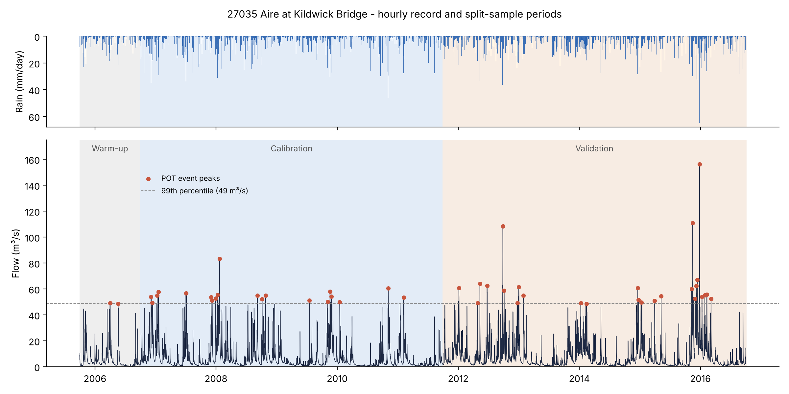
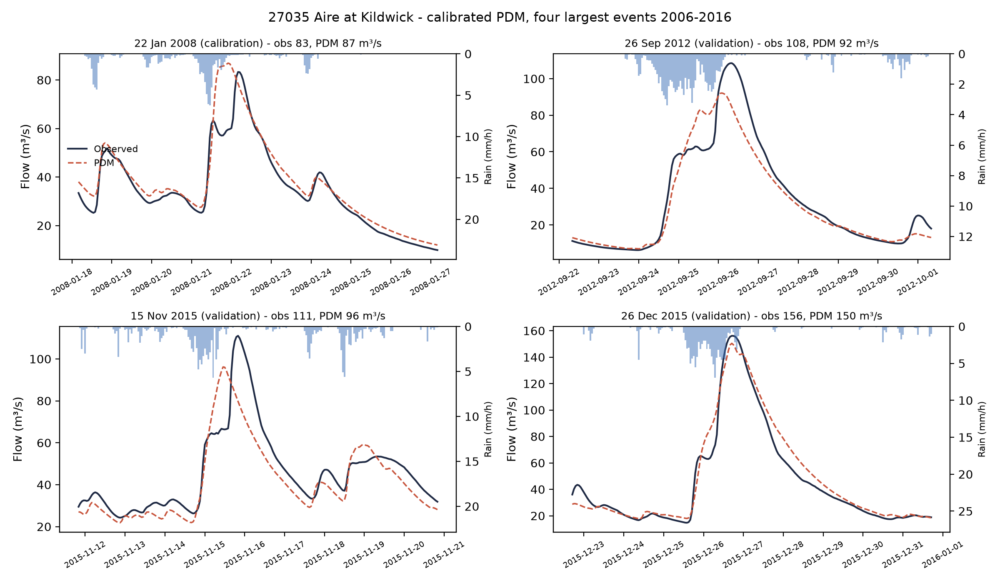
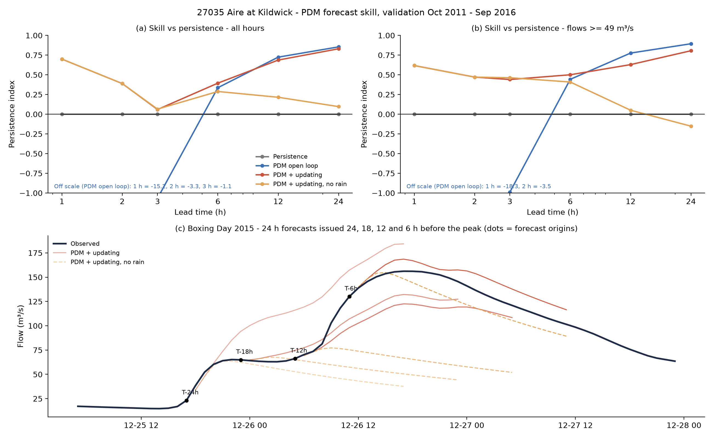
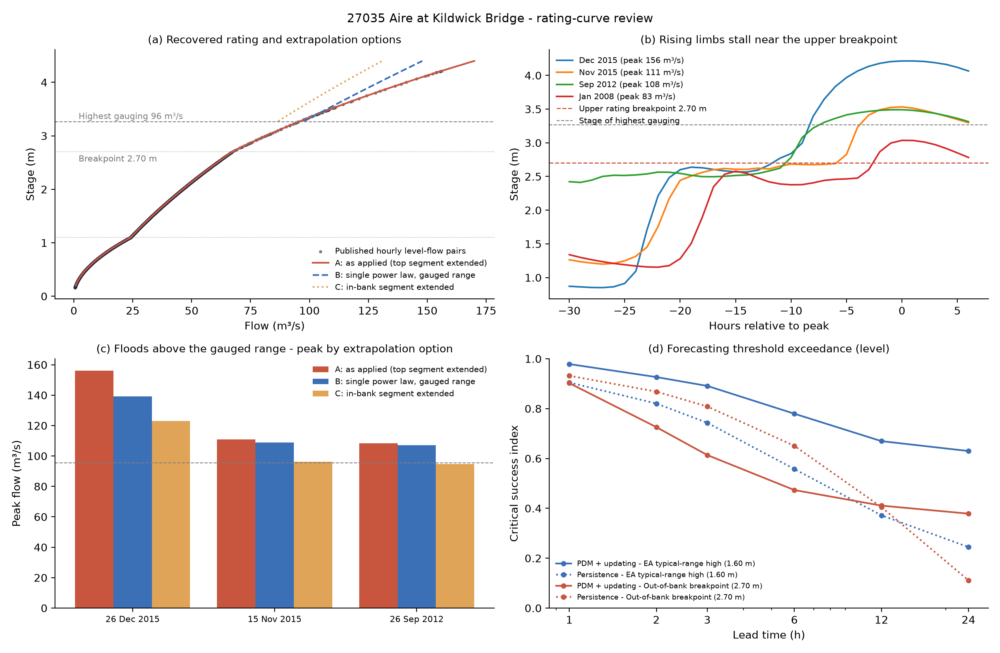
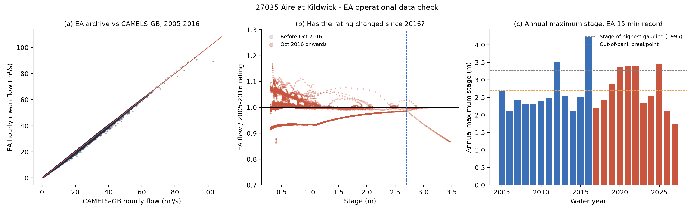

# Hourly flood forecasting with the PDM and a rating-curve review: River Aire at Kildwick Bridge

**Technical report | Raphel Etoyiva Abine | November 2026**

Station: 27035 Aire at Kildwick Bridge (EA station F1503), 283 km², North Yorkshire  
Data: CAMELS-GB v2 hourly (2005–2016), plus the EA Hydrology and Flood-Monitoring APIs (2005–2026)

---

## 1. Summary

I built a Probability Distributed Model (PDM), the conceptual model used in UK flood forecasting systems, and ran it as an hourly hindcast forecasting system for the River Aire at Kildwick. I then reviewed the stage–discharge rating behind the flow record it was calibrated against.

**Key findings**

1. **The model is accurate.** On unseen data (Oct 2011 – Sep 2016), hourly NSE is 0.92 and KGE 0.91. The Boxing Day 2015 flood, the largest in the 2005–2016 record (within 3 mm of the station's record stage) and nearly twice the largest calibration event, was simulated at 150 m³/s against 156 m³/s observed, with the peak in the right hour.
2. **Updating is essential for short lead times.** On its own, the model is worse than persistence at 1–3 h because of small timing errors. Error-prediction updating turns this around: at 3 h, the median error in the forecast flood peak falls from 23% to 4%, and at 6 h from 23% to 11%.
3. **About 3 h of lead time needs no rainfall forecast.** Forecasts that assume no further rain are as good as those given the rain that actually fell, up to 3 h. Beyond 6 h, skill depends on the rainfall forecast. Without one, the forecast is no better than persistence at 24 h.
4. **The largest flood flows are extrapolated and uncertain.** The highest gauging (95.5 m³/s) dates from 1995. Every flow above 3.23 m stage is flagged *Suspect* in the EA archive. For Boxing Day 2015, credible alternative extrapolations give 123–156 m³/s, up to 21% below the published figure.
5. **The EA re-rated the station from water year 2025 (October 2024 onwards).** Since then, flows are 11% lower at 3.2–3.4 m stage and 7% lower at about 1 m compared with the rating in use from 2005 to 2024. A model calibrated on the older record will over-forecast flows under the new rating.
6. **There is a physical "shelf" at about 2.5–2.7 m.** In every large flood, stage stalls on the rising limb for 6–21 hours just below an out-of-bank rating breakpoint at 2.70 m, then surges. The PDM doesn't represent this storage or bypass effect, and it is the main source of early or under-predicted peaks.

**Recommendations**

- Issue forecasts using the **updated PDM for lead times up to 6 h** and the **open-loop PDM driven by rainfall forecasts beyond 6 h**.
- **Forecast and warn on stage, not flow, above 3.2 m.** Flows there carry at least ±20% rating uncertainty, but stage is measured directly.
- **Recalibrate the PDM against the 2025 rating** before any operational use of flows.
- **Prioritise high-flow gaugings at Kildwick.** Nothing above 95.5 m³/s has been measured since 1995, yet stage has exceeded that level in six water years since 2012.
- **Represent the out-of-bank storage explicitly**, for example with a stage-dependent storage–routing term or an event-based correction, to fix the shelf behaviour that limits skill near the 2.7 m threshold.

---

## 2. Scope

This project follows on from a [daily rainfall–runoff benchmark](https://github.com/raphel-abine/uk-rainfall-runoff-benchmark) of GR4J, GR6J and an LSTM on 128 UK catchments. It moves from national screening to the operational problem: **hourly flood forecasting at one gauge, together with a check on the flow data that forecasting relies on.** It answers three questions:

| Question | Where it is answered |
|---|---|
| How well does a PDM forecast floods at lead times of 1–24 h, and how much does updating add? | Sections 4–6 |
| How reliable is the rating that turns measured stage into the flows used to calibrate and verify the model? | Section 7 |
| Does the operational EA record confirm the dataset, and has anything changed since? | Section 8 (EA Hydrology and Flood-Monitoring APIs) |

## 3. Catchment selection and data

### 3.1 Selection

Candidates were screened from CAMELS-GB v2 against these criteria:
- in England, so that EA data is available;
- in the UK Benchmark Network;
- 50–500 km²;
- responsive (baseflow index below 0.55);
- no hourly-flow issues flagged;
- at least 95% complete hourly flow and 90% complete hourly level for 2006–2016.

Fourteen stations passed (`results/pdm_catchment_candidates.csv`). Kildwick was chosen because:
- **It has a real rating to review.** It's a velocity-area station in a 21 m channel, with the old arched Kildwick Bridge acting as the hydraulic control. Peak flows reach 1.64 times the highest gauging. Weir and flume sites have theoretical ratings and less to review.
- **It's an operational EA flood-warning gauge** with a published stage scale.
- **The record is clean.** Flow and level are 100% complete for 2005–2016, with no suspect peaks in the CAMELS-GB QC.
- **It links to the [benchmark project](https://github.com/raphel-abine/uk-rainfall-runoff-benchmark).** The Aire was the one upland catchment where the GR models beat the LSTM there.

### 3.2 Data and design

| Item | Choice |
|---|---|
| Rainfall | CEH-GEAR1hr (gauge-based), hourly. GRaD-GB was checked but has gaps (68–98% complete). |
| Potential evaporation | Hydro-PE (daily), spread evenly over 24 h |
| Flow and stage | CAMELS-GB v2 hourly (from EA/NRFA) |
| Warm-up | Oct 2005 – Sep 2006 |
| Calibration | Oct 2006 – Sep 2011 |
| Validation | Oct 2011 – Sep 2016, as a continuous run (split-sample test; Klemeš, 1986) |
| Flood events | Peaks over threshold above the 99th percentile flow (49 m³/s), at least 5 days apart: 20 calibration and 26 validation events |

The water balance is consistent:
- rainfall 1,245 mm/yr;
- runoff 810 mm/yr, a runoff coefficient of 0.65;
- the implied evaporative loss of 435 mm/yr is below the PE of 496 mm/yr.

**Note on the split.** The three largest floods (Boxing Day 2015, November 2015, September 2012) all fall in the validation period, and all exceed the largest calibration flood (83 m³/s). So validation tests extrapolation, which is the hardest case for a forecasting model.


*Figure 1 – Hourly record, split-sample periods and flood events at Kildwick, 2005–2016.*

## 4. Model

### 4.1 PDM configuration

The PDM was implemented in Python (`pdm.py`) following Moore (2007), in the configuration commonly used for UK flood forecasting:

| Component | Formulation |
|---|---|
| Soil moisture | Pareto distribution of store capacities (c_min = 0); runoff from the saturated fraction, integrated analytically |
| Evaporation | E_a/E_p = 1 − ((S_max − S)/S_max)^b_e, with b_e = 2 |
| Drainage to groundwater | d = (S − S_t)^b_g / k_g, with b_g = 1 |
| Fast pathway | Two linear reservoirs in series (k1, k2) |
| Slow pathway | Cubic store, q_b = k_b S³ |
| Time delay | Integer τ_d (h) on the rainfall input |

**Numerical scheme.**
- Linear reservoirs use the exact solution for constant inflow over each time step.
- The cubic store uses an implicit step solved by Newton iteration.
- Both conserve mass to machine precision.
- Numba compilation makes an 11-year hourly run take 0.03 s, which makes global calibration practical.

### 4.2 Verification before use

| Test | Result |
|---|---|
| Water-balance closure over 96,432 hours | −4 × 10⁻¹² mm |
| 50 mm pulse from empty stores | All water accounted for (closure 7 × 10⁻¹³ mm) |
| Stress test: 5 × rain, 3 × PE, very fast stores | No NaNs, no negative storage |
| Restarting from saved states reproduces the continuous run | Exact (difference 0.0 m³/s) |

### 4.3 Calibration

- **Optimiser:** differential evolution (Storn and Price, 1997), with hourly NSE as the objective (Nash and Sutcliffe, 1970), the same measure as the benchmark project.
- **Search space:** eight parameters, with k_g and k_b searched in log space and τ_d as an integer.
- **Stability check:** three independent seeds reached the same optimum (NSE 0.9332–0.9333), and no parameter sat on a search bound.

| Parameter | Value | Meaning |
|---|---|---|
| c_max | 94.3 mm | Maximum store capacity |
| b | 0.145 | Pareto shape. A low value means capacities are fairly uniform. |
| k_g | 8.3 h | Drainage time constant |
| S_t | 0.975 S_max | Drainage threshold. Recharge happens only when the soil is near saturation. |
| k1, k2 | 0.9 h, 35.1 h | Fast routing pair |
| k_b | 4.03 × 10⁻⁷ mm⁻² h⁻¹ | Cubic baseflow constant |
| τ_d | 2 h | Time delay |

The time delay and the fast routing constant trade off against each other: seed 1 found τ_d = 1 h with k1 = 1.7 h at the same NSE. This makes no practical difference to the simulated flows.

## 5. Simulation performance

| Period | NSE | KGE | Bias | Baseflow share | Median peak error | Median timing error |
|---|---|---|---|---|---|---|
| Calibration 2006–2011 | 0.933 | 0.966 | +0.7% | 0.33 | 8.4% | 3.0 h |
| **Validation 2011–2016** | **0.922** | **0.909** | **−4.6%** | 0.35 | 19.0% | 2.5 h |

Peak and timing errors are for each POT event's simulated maximum within ±24 h of the observed peak.

| Event | Observed (m³/s) | PDM (m³/s) | Peak error | Timing |
|---|---|---|---|---|
| 26 Dec 2015 | 156.1 | 150.4 | −3.7% | 0 h |
| 15 Nov 2015 | 111.0 | 96.2 | −13.4% | 9 h early |
| 26 Sep 2012 | 108.5 | 92.1 | −15.1% | 6 h early |
| 22 Jan 2008 (calibration) | 83.3 | 86.9 | +4.4% | 6 h early |


*Figure 2 – The four largest events. The observed rising limbs stall at about 60–65 m³/s, then surge, and the PDM rises steadily instead. Section 7 explains why.*

## 6. Forecasting

### 6.1 Set-up

Forecasts were issued **every hour of the validation period** (about 43,800 forecast origins) at lead times of 1, 2, 3, 6, 12 and 24 h, with four methods:

| Method | Description |
|---|---|
| Persistence | Flow at the forecast origin carried forward. This is the benchmark. |
| PDM open loop | The model run with the rain that actually fell, a "perfect" rainfall forecast |
| **PDM + updating** | Open loop corrected by error prediction (Moore, 2007): an AR model of log-flow errors, fitted on calibration only. AR(4) was chosen by calibration skill. |
| PDM + updating, no rain | As above, but with zero rainfall after the origin. This is the worst case for the rainfall forecast. |

**Skill measure.** Skill is the **persistence index**, PI (Kitanidis and Bras, 1980): PI > 0 means the forecast beats persistence. NSE is not used at short lead times, because persistence alone scores NSE 0.995 at 1 h.

### 6.2 Results

**Persistence index, all hours (validation)**

| Lead | Open loop | + updating | + updating, no rain |
|---|---|---|---|
| 1 h | −15.2 | **0.70** | 0.70 |
| 2 h | −3.3 | **0.39** | 0.39 |
| 3 h | −1.1 | 0.06 | 0.06 |
| 6 h | 0.34 | **0.39** | 0.29 |
| 12 h | **0.72** | 0.69 | 0.22 |
| 24 h | **0.85** | 0.83 | 0.10 |

**Median absolute error in the forecast flood peak (26 validation floods; forecast issued *L* hours before the observed peak)**

| Lead | Persistence | Open loop | **+ updating** | + updating, no rain |
|---|---|---|---|---|
| 1 h | 0.9% | 23.1% | **0.6%** | 0.6% |
| 3 h | 8.3% | 23.1% | **4.4%** | 4.6% |
| 6 h | 29.1% | 23.1% | **11.0%** | 20.0% |
| 12 h | 43.8% | 23.1% | 21.5% | 55.3% |
| 24 h | 73.0% | 23.1% | 30.1% | 76.1% |


*Figure 3 – (a, b) Skill against persistence by lead time, for all hours and for high flows. (c) Boxing Day 2015: 24 h forecasts issued 24, 18, 12 and 6 h before the peak.*

### 6.3 Interpretation

- **Updating fixes the model's short-range weakness.** Small timing errors make the open-loop model much worse than simply carrying the current flow forward. Updating removes most of this, and up to 6 h it is the best method.
- **The catchment gives about 3 h of lead time for free.** The 2 h time delay plus fast routing means rainfall after the origin barely affects the 1–3 h forecast. This is the window in which a gauge-based warning can be issued without a rainfall forecast.
- **The benefit of updating fades beyond about 12 h**, and the open-loop model becomes marginally better. This is the expected behaviour of AR error predictors as the error autocorrelation decays.
- **Boxing Day shows how the rising-limb shelf drives forecast error** (Figure 3c). The forecast issued 24 h ahead, at the start of the rise, overshot to about 185 m³/s. The forecasts issued 18 and 12 h ahead, during the stall at about 65 m³/s, under-forecast the peak by 15–22%. The forecast issued 6 h ahead, after the stall, was within about 8%.

## 7. Rating-curve review

### 7.1 The rating in use for 2005–2016

The gaugings themselves aren't public, so I **recovered the rating from the published hourly stage–flow pairs**. I fitted a three-segment power law, Q = a(h − h₀)^b, with breakpoints chosen by least squares. This follows the multi-segment approach in ISO 18320.

| Segment | Stage range (m) | a | h₀ (m) | b |
|---|---|---|---|---|
| 1 – low flow | 0.16–1.10 | 21.20 | 0.03 | 1.88 |
| 2 – in-bank | 1.10–2.70 | 7.90 | −0.83 | 1.70 |
| 3 – out-of-bank | 2.70–4.21 | 4.50 | −0.62 | 2.25 |

- The fit reproduces the published flows with a **median error of 0.21%** (95th percentile 1.1%). The rating has effectively been reverse-engineered.
- **One rating was applied throughout 2005–2016.** At 2.0 m stage, flow varies only between 45.6 and 46.5 m³/s from year to year.

### 7.2 The rising-limb shelf

| Flood | Peak stage (m) | Hours stalled on the rising limb | Stall stage (m) |
|---|---|---|---|
| Dec 2015 | 4.21 | 6 | 2.59 |
| Nov 2015 | 3.53 | 9 | 2.62 |
| Sep 2012 | 3.49 | 21 | 2.52 |
| Jan 2008 | 3.04 | 6 | 2.43 |
| Dec 2015 (13th) | 2.69 | 12 | 2.48 |

- **Every large flood stalls at 2.43–2.62 m**, just below the upper breakpoint at 2.70 m, where the rating changes shape. Rain continues while stage holds steady, so water is either going into **out-of-bank storage upstream** or **bypassing the gauged section**. Washlands with raised embankments around Skipton and Cononley, upstream of the gauge, are known to attenuate some flood peaks.
- The rating is single-valued, so this is a real hydraulic or hydrological effect, not a quirk of the rating.
- **The PDM has no stage-dependent storage**, which explains its early, low peaks in November 2015 and September 2012.

### 7.3 Extrapolation above the highest gauging

- The highest gauging is **95.5 m³/s, measured on 1 February 1995**, reached at 3.27 m stage.
- There were 52 hours above that stage in 2005–2016, covering the Boxing Day 2015, November 2015 and September 2012 peaks.
- The published flows extend segment 3 upwards. An independent reviewer would test at least two alternatives:

| Flood (stage) | A: as published (segment 3 extended) | B: single power law over the gauged range | C: in-bank segment extended | Lowest vs A |
|---|---|---|---|---|
| 26 Dec 2015 (4.21 m) | 156.1 | 139.3 | 123.1 | **−21%** |
| 15 Nov 2015 (3.53 m) | 111.0 | 108.8 | 96.3 | −13% |
| 26 Sep 2012 (3.49 m) | 108.5 | 107.0 | 94.7 | −13% |

- Option C is the lower bound if the out-of-bank flow bypasses the gauged section.
- For comparison, CAMELS-GB's published discharge uncertainty for this station is about **±8–19% across the flow percentiles** (Coxon et al., 2015). Those bounds describe flows within the gauged range, and the uncertainty for extrapolated peaks is wider.
- **Implication for the model:** the PDM's −3.7% error for Boxing Day is well inside the uncertainty of the "observed" peak. Peak errors for the three largest floods should not be read more precisely than about ±15–20%.

### 7.4 Forecasting thresholds in stage

The forecast flows were converted to stage with the recovered rating and checked against two thresholds:
- **1.60 m**, the top of the EA's published "typical range";
- **2.70 m**, the out-of-bank breakpoint.

The EA's flood-warning thresholds are not published, so these are proxies. The score is the critical success index (CSI), where 1 is perfect.

| Lead | 1.60 m: PDM + updating | 1.60 m: Persistence | 2.70 m: PDM + updating | 2.70 m: Persistence |
|---|---|---|---|---|
| 1 h | **0.98** | 0.90 | 0.90 | **0.93** |
| 3 h | **0.89** | 0.74 | 0.61 | **0.81** |
| 6 h | **0.78** | 0.56 | 0.47 | **0.65** |
| 12 h | **0.67** | 0.37 | **0.41** | 0.40 |
| 24 h | **0.63** | 0.24 | **0.38** | 0.11 |

- **For the in-bank 1.60 m level, the PDM beats persistence at every lead time.**
- **For the out-of-bank 2.70 m level, persistence wins up to 6 h.** Stage stalls just below the threshold and the model doesn't, so the model calls the crossing early. This is the operational cost of the missing out-of-bank process.


*Figure 4 – (a) Recovered rating and extrapolation options. (b) Rising-limb stalls near the 2.70 m breakpoint. (c) Peak flows above the gauged range under each option. (d) Threshold forecasting skill.*

## 8. EA operational data check

I downloaded 15-minute stage and flow for station F1503 from the EA Hydrology API for January 2005 to November 2026 (743,489 paired readings), together with its published stage scale from the Flood-Monitoring API.

| Check | Result |
|---|---|
| CAMELS-GB vs EA archive, 2005–2016 | Identical once aligned. The best match is at a 1 h offset, because CAMELS labels the hour by its end. r = 0.9998 for flow and 0.9999 for stage, with 0.00% mean difference. |
| Published stage scale | Typical range 0.19–1.60 m. Record maximum 4.222 m (31 Oct 2000). Boxing Day 2015 reached 4.219 m, 3 mm below the record. |
| Quality flags on flood flows | **Every flow above 3.23 m stage (about 93.8 m³/s) is flagged *Suspect*,** while stage stays *Good*. This was checked for Dec 2015, Sep 2012 and Feb 2020. The EA does not vouch for flows above its gauged range. |
| Rating changes | **The rating was revised from water year 2025** (Table below) |
| Recent floods | Stage exceeded the highest gauging (3.27 m) in water years 2012, 2016, 2020, 2021, 2022 and 2025 |

**EA flow divided by the 2005–2016 rating (median by water year and stage band)**

| Water year | 0.9–1.1 m | 1.9–2.1 m | 2.6–2.8 m | 3.2–3.4 m |
|---|---|---|---|---|
| 2005–2024 | 0.998–0.999 | 1.000 | 0.995–1.000 | 1.00 |
| **2025 onwards** | **0.934** | **0.975** | **0.985** | **0.89** |

The 2025 revision **lowers flows at both ends of the range**: by about 7% at low stage and **11% at flood stage**. That direction matches alternatives B and C in Section 7.3, and it suggests the earlier extrapolation was overestimating flood flows.


*Figure 5 – (a) EA archive against CAMELS-GB. (b) EA flow relative to the 2005–2016 rating, showing the 2025 revision. (c) Annual maximum stage, 2005–2026.*

## 9. Limitations

- **Hindcast with observed rainfall.** The "perfect rainfall" and "no rain" runs bracket real performance. A live system would use radar nowcasts and NWP rainfall, whose errors would sit between the two.
- **Gauge-based rainfall.** CEH-GEAR1hr is a reanalysis product and is not available in real time. Operational skill with real-time radar would be lower.
- **One catchment, one event population.** The results show the method works but are not a regional assessment.
- **The rating was recovered, not obtained.** The gaugings and the official rating equations were not available, and the 2025 rating was inferred from the published flows.
- **Proxy thresholds.** The EA's flood-warning trigger levels are not public, so 1.60 m and 2.70 m stand in for them.
- **Simple PE disaggregation.** Daily PE was spread evenly over 24 h. This has a negligible effect on flood response.
- **Upstream storage is not modelled.** The Skipton and Cononley washlands are lumped into the catchment response.

## 10. Next steps

1. Add a **stage-dependent storage term** for the out-of-bank shelf and retest threshold skill at 2.70 m.
2. **Recalibrate against the 2025 rating**, and compare forecasts made in flow and in stage.
3. Replace observed rainfall with **archived radar nowcasts** to measure real-time skill.
4. Produce **probabilistic forecasts** that combine rating uncertainty (Section 7.3) with rainfall-forecast uncertainty.
5. **Compare the PDM with the LSTM** from the [benchmark project](https://github.com/raphel-abine/uk-rainfall-runoff-benchmark) at an hourly time step for the same events.

## 11. Reproduction

### Repository layout

```
aire-pdm-flood-forecasting/
├── README.md        this report
├── LICENSE          MIT (code)
├── requirements.txt
├── figures/         Figures 1–5
├── results/         all tables and fitted parameters behind the report
└── scripts/
    ├── config.py                  paths: set CAMELS_GB_DIR and PDM_OUTPUT_DIR
    ├── pdm.py                     PDM model (Moore 2007), numba-accelerated
    ├── 01_select_catchment.py     screen and rank candidate catchments
    ├── 02_build_dataset.py        hourly dataset and flood events (Figure 1)
    ├── 03_verify_pdm.py           water-balance and stress tests
    ├── 04_calibrate.py            calibration with 3 seeds (Figure 2)
    ├── 05_forecast.py             hindcast forecasts and skill (Figure 3)
    ├── 06_rating_review.py        rating review and level thresholds (Figure 4)
    ├── 07_ea_data_check.py        EA archive check and re-rating (Figure 5)
    └── 07b_ea_quality_flags.py    EA quality flags on flood flows
```

### Running it

1. Install Python 3.11 or later and the packages listed in `requirements.txt` (`pip install -r requirements.txt`).
2. Download CAMELS-GB v2 from the EIDC (free account). Then set two environment variables:
   - `CAMELS_GB_DIR` to the download folder;
   - `PDM_OUTPUT_DIR` to an output folder.

   If you don't set them, the scripts use `data/` and `outputs/` inside the repository. If an hourly or daily file is missing, the scripts download it from the EIDC using a Personal Access Token. They read the token from `EIDC_TOKEN` or ask you to type it, and never store it.
3. Run the scripts in order from the `scripts` folder: `python 01_select_catchment.py`, then `02` to `07b`. The EA steps need internet access but no API key.

| Step | Run time on a desktop PC |
|---|---|
| 04 calibration | About 4 minutes |
| 07 first EA download | A few minutes, then cached |
| All other steps | Under 2 minutes |

Rerunning steps 03–07b reproduces every table in `results/` exactly. Calibration is seeded, so the same parameters come back each time.

The scripts regenerate the large intermediate files, so these are not in the repository: the hourly dataset, the continuous simulation and the EA 15-minute cache (about 50 MB).

## 12. Licences

- **Code:** MIT licence (see `LICENSE`).
- **CAMELS-GB v2:** UKCEH, EIDC, doi:10.5285/9a46d428-958f-4ac1-86eb-94eee70c0955. Contains data supplied by UK Centre for Ecology & Hydrology, British Geological Survey, Environment Agency, Natural Resources Wales and Scottish Environmental Protection Agency.
- **EA Hydrology and Flood-Monitoring APIs:** this uses Environment Agency data. Contains public sector information licensed under the Open Government Licence v3.0.

## 13. References

- Coxon, G., Freer, J., Westerberg, I.K., Wagener, T., Woods, R. and Smith, P.J. (2015) A novel framework for discharge uncertainty quantification applied to 500 UK gauging stations. *Water Resources Research*, 51, 5531–5546.
- Gupta, H.V., Kling, H., Yilmaz, K.K. and Martinez, G.F. (2009) Decomposition of the mean squared error and NSE performance criteria. *Journal of Hydrology*, 377, 80–91.
- ISO 18320:2020 *Hydrometry – Measurement of liquid flow in open channels – Determination of the stage–discharge relationship.* International Organization for Standardization.
- Kitanidis, P.K. and Bras, R.L. (1980) Real-time forecasting with a conceptual hydrologic model: 2. Applications and results. *Water Resources Research*, 16(6), 1034–1044.
- Klemeš, V. (1986) Operational testing of hydrological simulation models. *Hydrological Sciences Journal*, 31(1), 13–24.
- Moore, R.J. (2007) The PDM rainfall-runoff model. *Hydrology and Earth System Sciences*, 11(1), 483–499.
- Nash, J.E. and Sutcliffe, J.V. (1970) River flow forecasting through conceptual models part I – A discussion of principles. *Journal of Hydrology*, 10(3), 282–290.
- Storn, R. and Price, K. (1997) Differential evolution – a simple and efficient heuristic for global optimization over continuous spaces. *Journal of Global Optimization*, 11, 341–359.
